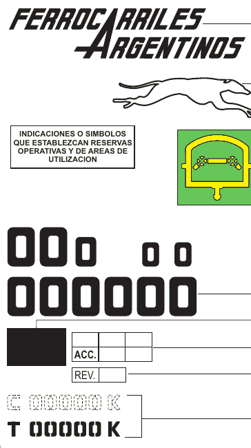

# FA freight cars: reference

Load limits, tares and markings of Ferrocarriles Argentinos broad-gauge
(1676 mm) freight cars, for the game's cars. Researched 2026-10-08 (#18, #54);
lengths added 2026-10-13 (#54) and 2026-11-24 (#98), couplers 2026-11-24
(#33).

**Decided (Tom):**
- **Car marks: both kinds** (2026-10-08, #54). Most cars carry FA's
  unified panel (monogram and type code); a few not yet repainted keep
  their line's initials. The share is retunable.
- **Paint: FA's colours** (2026-10-08, #64), grey box, grain and open
  cars alike; cars still in line marks keep an older brown.

**Status:** load limits, some tares, the numbering, the marking layout and
the paint colours are **Confirmed**, read on FA's own technical
specifications (FAT) and drawings (NEFA), hosted by CNRT. **Lengths: two
kinds found.** No general-arrangement drawing of a game car is on CNRT's
site, but detail sheets give the grain hopper about **15.0 m** and the 50 t
box car about **13.5 m** over buffers (both derived). For the borde alto,
jaula and tank, a state-railway diagram book gives older 28–45 t
broad-gauge cars of **11.0–13.2 m**, which bounds them (derived). Two-axle
cars ran until 1989, but how many and how long weren't found. Open gaps:
#112.

## Load limits and tares

| Kind | Load limit | Tare | Source | Status |
|---|---|---|---|---|
| Vagón borde alto (high-side gondola) | 60 t | at most 20.0 t ± 0.2, bogies included | FAT V-1529, July 1977 | Confirmed |
| Vagón borde alto, broad and standard gauge | 59 t | — | FAT V-1527, May 1975 (CNRT's index lists it as 50 t; the document says 59) | Confirmed |
| Tolva granero (grain hopper) | 58 t | — | FAT V-1539 (title, on CNRT's index) | Confirmed |
| Tolva cubierta para cereal a granel | 50 t | — | FAT V-1500 (title) | Confirmed |
| Tolva para cemento a granel | 60 t | — | FAT V-1519, June 1974 | Confirmed |
| Tolva pedrero (ballast hopper) | 59 t | body 13.4 t, without bogies | FAT V-1530, May 1987 | Confirmed |
| Plataforma for three 20 ft (1C) containers | 61 t | at most 19.0 t, bogies included | FAT V-1520, December 1989 | Confirmed |
| Vagón mixto, rails and containers | — | 19.5 t ± 0.5, two bogies of about 4.25 t each | FAT V-1545, October 1981 | Confirmed |
| Vagón tanque | 60 m³ tank | — | FAT V-1548 (title: frame for a 60 m³ tank) | Confirmed |
| Vagón cubierto todo uso, broad gauge | 50 t | — | A web search summary of the NEFA drawing index; not seen on the page | Unconfirmed |

A broad-gauge bogie, as used under these cars, weighs about 4.25 t (FAT
V-1545), so a bogie car's tare is its body plus about 8.5 t.

## Numbering and marking

From FAT MRe-2002, "Marcado unificado de vehículos de carga", June 1988,
which applies the March 1971 recoding and renumbering of FA's wagons.
**Confirmed**.

- **An 11-digit code**, painted in two rows of six columns:
  - first row: **type** and **sub-type** (traffic code, NEFA 958), an
    **operating** digit (speed, gauge change, rack and mountain working;
    NEFA 956), and the **mechanical class and sub-class** (metal,
    part-metal or wooden; NEFA 957);
  - second row: the **car number**, five digits, then a **check digit**.
- **Car numbers by gauge:** 1000–7999 standard (1435 mm), 8000–39999 metre
  (1000 mm), **40000–99999 broad (1676 mm)**.
- The number is also painted near the top right of both ends, and punched
  into the frame's right-hand ends.
- A card holder for the **destination card** (ficha de destino) sits on the
  side (NEFA 410).
- **Colours:** FAT V-1520 (1989) gives a **black frame** and **white
  lettering**. Body colours per car kind are in NEFA 560 (tank cars), 561
  (box cars) and 562 (open cars), unread.
- The numbers' shapes and the standard letters are NEFA 938 and 674; the
  layout per kind is NEFA 543 (box), 544 (high side), 547 (tank), 548
  (flat).

### Type codes (NEFA 958, read 2026-10-08)

The first two digits of the code's top row: **type**, then **sub-type**.
Confirmed, NEFA 958 issue 12 (1992). The kinds the game uses:

| Type | Kind | Sub-types that matter here |
|---|---|---|
| 1 | Cubierto, carga general, no grain hatch | 0–6 by load: up to 19 t … 6 = over 50 t |
| 2 | Cubierto, carga general, grain hatch | 0–6 by load; **7, 8, 9 = vagón para ganado** (one deck, two decks, convertible) |
| 3 | Cubierto granero | 0–6 by load (6 = 50 t and over) |
| 5 | Abierto | 0–4 costados fijos altos by load (3 = 40–50 t, 4 = over 50 t); 5–8 costados bajos |
| 6 | Plataforma | 0–3 by headstock and 12.5 m length; 4 = two containers, 8 = three containers |
| 7 | Tolva | 0 cemento; 1–3 piedras; 4 granero convertible; 5 graneros |
| 8 | Tanque | 0 petróleo y fuel-oil; 1 nafta y kerosene; 2 gas oil y diesel oil; 6 agua |
| 9 | Tanque | 0 aceites vegetales; 6 vinos y jugos |
| 0 | Servicio interno | 7 = vagón de cola |

So a **jaula (stock car) is a type 2 cubierto in FA's code**, sub-type 7–9,
not a kind of its own. Examples: a 60 t borde alto is **54**, a 58 t tolva
granero **75**, a 50 t covered car with a grain hatch **26**, a gasoil tank
**82**.

The third digit (NEFA 956) is the operating code: **3** is plains, low
speed; **2** plains, high speed (the galgo, greyhound, symbol); 0–1 are
privately owned. The fifth and sixth digits (NEFA 957) are the mechanical
class: metal, part-metal or wooden body, and the bogie and bearing type.
The fourth column of the top row is left blank (NEFA 553).

### The side panel (NEFA 555, 553, 771)

*NEFA 555, CNRT copy, cropped.* Confirmed. At the right-hand end of each
side, top to bottom:

1. **The FERROCARRILES ARGENTINOS monogram** (NEFA 485). **No line
   initials:** the unified marking of 1976 (NEFA 555 issue 3) and MRe-2002
   put FA's monogram at the top of the panel. A car got it when next
   repainted (MRe-2002 D-1), so in the late 1970s and 80s cars with old
   line marks and cars with the FA panel likely ran together (my
   inference, not read anywhere).
2. The **greyhound** (NEFA 487) on cars passed for high speed.
3. Symbols for operating restrictions, and the **brake symbol** (NEFA
   532–539: vacuum, air, or through pipe only).
4. **The code**: top row type, sub-type, operating digit, blank, mechanical
   class; bottom row the five-digit car number and the check digit, 180 mm
   high (NEFA 553).
5. Damage-label panel (NEFA 549), repair grid **ACC.** and **REV.** (550,
   940).
6. **C 000000 K** and **T 00000 K**, 63.5 mm high (NEFA 771): the tare in
   kilograms, rounded to the nearest 50 kg, weighed in the shops with the
   car uncoupled; optionally followed by the month and year as the tare's
   expiry. C is drawn dashed above it. That C is the load limit in kilograms
   is my reading; the drawing doesn't say.
7. The destination-card holder (NEFA 410).

So a stencil reads, for example, **T 20000 K** and **C 060000 K**.

### Paint (NEFA 560, 561, 562)

Colours to IRAM DEF D10-54. Confirmed. Lines didn't differ: these are
FA-wide.

| Kind | Body | Frame | Lettering | Other |
|---|---|---|---|---|
| Cubierto, general | grey 09-1-140, roof grey | grey | white | |
| Cubierto granero only | grey | grey | white | yellow triangles |
| Hacienda (stock) | grey | grey | white | two boards white |
| Abierto (borde alto) | grey 09-1-140 | grey | white | |
| Plataforma for containers or bulk cement | yellow 05-1-070 | black | black | yellow floor |
| Tanque, gasoil, diesel, kerosene | black 11-1-070 | black | white | yellow band, black dome |
| Tanque, petróleo, asfalto | black | black | white | black band and dome |
| Tanque, nafta, solvents | white 11-1-010 | black | black | white band and dome |
| Tanque, agua | grey | black | white | grey band and dome |

Bogies black, brake wheels white on all of them. Private-owner cars blue
08-1-080 with white lettering. FAT V-1520 (1989) gives the container flat a
black frame and white lettering; NEFA 562 (issue 8) gives yellow body,
black frame and black lettering.

## Couplers and buffers

FAT V-1527 and V-1529 give the borde alto **side buffers 1850–1860 mm
apart** and a **screw coupling** on the central draw hook, with brackets
for a future automatic coupler. Confirmed. Which coupler each kind of FA
vehicle carried, and the standards behind it, is in
[train-physics.md](train-physics.md#couplers): in short, the whole
broad-gauge fleet ran on buffers and the hook, with the screw coupling on
bogie cars and a chain link on two-axle cars.

## Length clues

FA's broad-gauge cars ran on side buffers and a screw coupling (above), so
the length that matters is **over buffers**: over headstocks plus two
buffers. No drawing found gives it directly. What was found:

- **Buffers stand 520 mm off the headstock.** FA's standard friction buffer
  (FAT V-709, read in CNRT's *Manual de seguridad en la circulación para
  vagones*, 2024) is 520 ± 5 mm long unloaded; FAT V-1519 allows 520–584
  mm. So **over buffers = over headstocks + about 1.04 m.** Confirmed.
- **Tolva granero, series 83700–83901 and 84300–84499** (NEFA 24.381,
  gauge 1435–1676): **10,720 mm between bogie centres**, and **1,625 mm
  from bogie centre to headstock**. So **13.97 m over headstocks and about
  15.0 m over buffers.** The drawing gives one end; the other is taken as
  the same. Confirmed for the drawing's figures, derived for the length.
  The sheets carry no date; the numbers are in FA's broad-gauge range
  (40000–99999).
- **Vagón cubierto todo uso, 50 t** (2026-11-24): NEFA 594, the box car's
  roof, gives **12,402 mm "entre paneles de frente y sobre cabezales del
  bastidor"** (between the end panels, over the headstocks), with 2,760
  mm between the side soles. So **about 13.5 m over buffers**. Confirmed
  for the drawing's figure, derived for the length. The sheet names no
  gauge or date. It's tied to the broad-gauge 50 t car of NEFA 29.0xx
  (dated 10 February 1971) by its width: NEFA 29.016 gives the same roof
  2,770 and 2,950 mm wide. A cross-check fits: NEFA 29.007 gives ten
  side panels per side (four of 1,016 mm, six of 956 mm), which with
  NEFA 29.006's 1,930 mm door make about 11.6 m of wall before corner
  posts, inside a 12.4 m frame. Derived.
- **An old bogie car, class C 19** (NEFA 1267, gauge 1676, converted to
  carry rail): frame **10,973 mm (36 ft)** with bogie centres 7,011 mm
  (23 ft). So about **12.0 m over buffers**. Round feet point to a car
  built for the British-owned companies (inferred). Confirmed for the
  frame, derived for the length.
- **Tolva pedrero, broad gauge** (NEFA 32.060): side sill **10.43 m**.
  Confirmed. Over buffers is longer by the headstocks and buffers; about
  11.5–12 m, Unconfirmed.
- **Tanque monocasco** (NEFA 25.015, 25.024): frame **12.7 m**, barrel
  **11,140 mm** at 1,270 mm inner radius, drawn for **metre gauge**
  (title block: trocha 1000). Confirmed. Not a broad-gauge car, but it
  sizes a tank of about 56 m³ plus its heads.
- **Broad-gauge petroleum tank, 1948** (NEFA 833, the British companies'
  ABGS drawing 707, "Argentine broad gauge standard"): its heating coil is
  **9,804 mm** long inside a tank of about 1.22–1.25 m radius. So a barrel
  of about 10–10.5 m and about 50 m³. Confirmed for the figures, derived
  for the barrel (the drawing is broken, so it can't be scaled).
- **So a 60 m³ broad-gauge tank** is about 10.5–12.2 m of barrel at 2.5–2.7
  m diameter, and with a frame about 1 m longer and the buffers, **12.5–13.5
  m over buffers, about 13.0 m.** Derived, weak. FAT V-1548 (its frame)
  still won't download.
- **Older broad-gauge bogie cars, 1910–1945** (2026-11-24): the wagon
  diagram book of the Ferrocarriles del Estado's broad-gauge Patagonian
  lines (San Antonio Oeste–Bariloche and others; part of the Roca from
  1948), scanned by Sergio Barral on Railways of the Far South, gives
  lengths in mm. Confirmed for the figures, read off the scans:

  | Series | Kind | Built | Capacity | Bogie centres | Body | Over buffers |
  |---|---|---|---|---|---|---|
  | 600 | Cubierto | 1910, Ringhoffer | 40 t | 7,550 | 10,510 | **11,510** |
  | 1500 | Cubierto | 1910, Cie de Fer, Paris | 45 t | 10,200 | 11,800 | **12,930** |
  | 3000 | Cubierto, wooden body | 1925, Familleureux | 40 t | 8,000 | 12,180 | **13,180** |
  | 1000 | Hacienda convertible (cattle, two decks) | 1924–25, rebuilt on flats | 40 t | 7,830 | 10,500 | **11,500** |
  | 1200 | Hacienda, two decks | 1945, rebuilt on flats | 40 t | 8,000 | 12,130 | **13,190** |
  | 6000 | **Borde alto** | 1926, rebuilt on flats | 40 t | 8,000 | 12,190 | **13,190** |
  | 7000 | Plataforma | 1925, Familleureux | 40 t | 8,000 | 12,190 | **13,190** |
  | 4500 | Tanque (water, petrol) | 1933, Tafí Viejo | 30 t | 6,840 | | **11,530** |
  | 4500 | Tanque, petrol (ex Leeds Forge flats) | 1936, 1947–48 | 28 t | 6,880 | | **10,986** |

  The drawings show buffers of 500–565 mm each side, matching FA's 520 mm.
  These are not San Martín cars, and they are older and lighter than the
  1970s 50–60 t cars; no BAP diagram was found. Unconfirmed that the San
  Martín's cars were similar.
- **Borde alto:** no FA-era length found (2026-11-24). The 1926 40 t borde
  alto above is **13.19 m**; a 1970s 60 t car is heavier and no shorter,
  so **about 13.5 m (13.2–14 m)**. Derived. FAT V-1527 and V-1529 give
  none; NEFA 544, its marking layout, isn't drawn to scale. World Bank 1979
  (Annex, item 20) planned to **replace 256 old broad-gauge high-sided
  wagons with 128 new ones**, so the old ones carried about half a new
  one's load. Confirmed for the figures; that they were shorter or
  two-axle is an inference.
- **Jaula:** no FA-era drawing found. It's a type 2 cubierto in FA's code.
  The newest cattle car in the diagram book (1945) is **13.19 m**, one of
  1924 11.5 m, so **about 13.5 m (13.2–13.5 m)**, the box car's length.
  Derived.
- **Tank, cross-check:** the diagram book's 28–30 t tanks are 11.0–11.5 m;
  a 60 m³ tank needs about 2 m more barrel, which fits the 13.0 m above.
  Derived.
- **Length classes** (NEFA 429, broad gauge, 1962): buffer face sizes are
  set for vehicles **up to 15.25 m**, 15.25–19 m and over 19 m over
  buffers, so 15.25 m was the ordinary upper limit for a car. Confirmed.
- **Rail wagon** (NEFA 1037, revised 1983): **18,650 mm** over headstocks,
  so about 19.7 m over buffers. Derived.
- **Container flat**: three 20 ft (6.06 m) containers, so at least 18.2 m
  of deck. Derived.

- **Much of the fleet was old and shorter.** At the end of 1977, 19,770
  of FA's 34,169 broad-gauge freight cars (58%) were over 40 years old,
  that is built before about 1938 (World Bank 1979, Table 2.5), and
  two-axle broad-gauge cars still ran, always at the rear of a train
  (RITO art. 203, [fa-yard-operations.md](fa-yard-operations.md)), and
  were still in the 1993 rulebook (arts. 196, 210). How many were
  two-axle: not found (2026-11-24); World Bank Tables 2.2 and 2.5 don't
  split the fleet by axles. **Unbraked two-axle cars stayed in use until
  1989** and held train speeds down (Müller 2012, in
  [fa-car-turnaround.md](fa-car-turnaround.md); Secondary), and FA's 1972
  maintenance instruction MR4-002 still has a task sheet for "Suspensión
  (vagones de dos ejes)" (Confirmed). On the state's Patagonian line the
  two-axle wagons (built 1890–1898) carried **10–12 t**, against 37–45 t
  for its bogie cars (Railways of the Far South, from the 1912–1955 stock
  lists; Secondary). FA planned to scrap 5,464 broad-gauge commercial
  wagons in 1978–81, about 17% of the fleet, by type, not by axles (World
  Bank 1979, Table 2.6; Confirmed). Reading (mine): two-axle cars were a
  small, shrinking share by the game's era, in local and work trains. How long: no NEFA sheet of a two-axle
  broad-gauge wagon found. British four-wheel wagons of the period were
  typically 18–24 ft (5.5–7.3 m) over headstocks, so **about 8 m over
  buffers**: Assumed, from general British practice, not an Argentine
  source.

Would confirm the rest: NEFA 254 (V-1529's general arrangement), NEFA
32.000 (V-1530's), FAT V-1548's drawings (60 m³ tank), an FA rolling-stock
inventory by axles, or a dated photo of a car's length stencil or of a
two-axle wagon side-on (scaled by its wheels). Searched and not
found 2026-10-13: modern tender sheets, builders' pages and modelling
sites give no broad-gauge length.

## In the game

What `index.html` uses, and where it comes from. **Estimated** values are
Unconfirmed and retunable.

| Kind | Length over couplers | Tare | Load limit |
|---|---|---|---|
| Vagón cubierto | 15.5 m, estimated; **FA's is about 13.5 m** (NEFA 594, derived) | 21 t, estimated | 50 t, Unconfirmed (above) |
| Tolva cerealera | 15 m; matches NEFA 24.381 (15.0 m, derived) | 21 t, estimated | 58 t, FAT V-1539 |
| Borde alto | 14 m, estimated; **about 13.5 m** derived (a 1926 one is 13.19 m) | 20 t, FAT V-1529 | 60 t, FAT V-1529 |
| Plataforma | 19.5 m, estimated from three 6.06 m containers | 19 t, FAT V-1520 | 61 t, FAT V-1520 |
| Vagón tanque | 14 m, estimated; **about 13.0 m** derived (weak) | 21 t, estimated | 50 t: 60 m³ of gasoil at about 0.84 t/m³, derived |

- A loaded car carries its full load limit, so a loaded car weighs 71–80 t
  and an empty one 19–21 t. The game's earlier box cars were 60 t loaded
  and 25 t empty, the figures in [train-physics.md](train-physics.md)'s
  worked example.
- Most cars carry the FA panel: FA, the type code's first three digits
  (type, sub-type, operating digit 3) and the number, with **T** and **C**
  stencils in kg. Two not yet repainted keep a broad-gauge line's initials
  (FCDFS, FCGR) and an older brown, whose real shade isn't recorded. Which
  numbers go to which kind, and which cars keep line marks, is the game's.
- Paint is FA's (table above), except the gasoil tank's black, lightened so
  it shows on the black yard.

**Where the game and FA still differ:**

- **The box car is 2 m long**: 15.5 m in the game, about 13.5 m on FA's
  drawing. The tank is likely about 1 m long. Changing them is Tom's call.

- **The code is cut short.** The card shows the type, sub-type and
  operating digit (for example **54 3** for a 60 t borde alto), not the
  mechanical class or the check digit, whose formula wasn't found.

## Sources

- [Planos NEFA, CNRT](https://www.argentina.gob.ar/cnrt/planos-nefa): [NEFA 24.381](https://www.argentina.gob.ar/sites/default/files/subidos_tanda_6/NEFA_24381.pdf) (grain hopper, apoyo lateral gato) and [NEFA 1267](https://www.argentina.gob.ar/sites/default/files/subidos_tanda_5/NEFA_1267.pdf) (C 19 car converted for rail): read 2026-10-13.
- [Manual de seguridad en la circulación para vagones](https://servicios.infoleg.gob.ar/infolegInternet/anexos/405000-409999/407992/res61.pdf), CNRT, edition 01, 15 November 2024: quotes FAT V-709 (standard friction buffer). Read 2026-10-13.
- [FAT V-1519](https://www.argentina.gob.ar/sites/default/files/normas_fat/FAT_V_1519.pdf): buffer length range. Read 2026-10-13.
- World Bank 1979, Table 2.5 (age of freight wagons): see [fa-freight-traffic.md](fa-freight-traffic.md).

- Read 2026-11-24 (#98): [NEFA 594](https://www.argentina.gob.ar/sites/default/files/para_reemplazar-20181105t152627z-001/Para%20reemplazar/NEFA_594.pdf) (box car roof), [29.006](https://www.argentina.gob.ar/sites/default/files/subidos_tanda_6/NEFA_29006.pdf), [29.007](https://www.argentina.gob.ar/sites/default/files/subidos_tanda_6/NEFA_29007.pdf), [29.016](https://www.argentina.gob.ar/sites/default/files/subidos_tanda_6/NEFA_29016.pdf) (50 t box car, 1971), [25.024](https://www.argentina.gob.ar/sites/default/files/para_reemplazar-20181105t152627z-001/Para%20reemplazar/NEFA_25024.pdf) (monocoque tank barrel), [833](https://www.argentina.gob.ar/sites/default/files/subidos_tanda_4/NEFA_833.pdf) (1948 broad-gauge tank), [429](https://www.argentina.gob.ar/sites/default/files/subidos_tanda_2/NEFA_429.pdf) (draw gear and buffers, 1962), [544](https://www.argentina.gob.ar/sites/default/files/subidos_tanda_3/NEFA_544.pdf) (borde alto marking), [1037](https://www.argentina.gob.ar/sites/default/files/subidos_tanda_5/NEFA_1037.pdf) (rail wagon); World Bank 1979, Annex item 20 (wagon replacement).
- Read 2026-11-24 (#98, second pass): Ferrocarriles del Estado broad-gauge wagon diagram book, scanned by Sergio Barral, [Railways of the Far South, Appendix 9](https://railwaysofthefarsouth.co.uk/04x9fcewagondiag.html) (copies of the nine pages in the project files, `research/cars/fce-diagrams/`); [Bariloche line rolling stock](https://railwaysofthefarsouth.co.uk/04Sesanantstock.html) (stock lists 1912–1955), Secondary; World Bank 1979, Table 2.6 (freight wagon scrapping program); Instrucción Técnica MR4-002 (September 1972), Anexo 2 (copy in the project files, `research/fa-operations/`).
- Not on CNRT's site (listed, no file), 2026-11-24: NEFA 19.003 and 19.067 (borde alto frame), 25.010, 25.018 and 832 (tanks), 439 (hacienda).
- [Especificaciones FAT, CNRT](https://www.argentina.gob.ar/cnrt/especificaciones-fat): the index of FA's technical specifications, with titles and capacities.
- [FAT V-1520](https://www.argentina.gob.ar/sites/default/files/normas_fat/FAT_V_1520.pdf), [FAT V-1527](https://www.argentina.gob.ar/sites/default/files/normas_fat/FAT_V_1527.pdf), [FAT V-1529](https://www.argentina.gob.ar/sites/default/files/normas_fat/FAT_V_1529.pdf), [FAT V-1530](https://www.argentina.gob.ar/sites/default/files/normas_fat/FAT_V_1530.pdf), [FAT V-1545](https://www.argentina.gob.ar/sites/default/files/normas_fat/FAT_V_1545.pdf): read 2026-10-08.
- [FAT MRe-2002, marcado unificado](https://www.argentina.gob.ar/sites/default/files/normas_fat/FAT_MRe_2002.pdf): read 2026-10-08.
- [Planos NEFA, CNRT](https://www.argentina.gob.ar/cnrt/planos-nefa): drawing titles (NEFA 543–562, 674, 938, 956–958).
- NEFA drawings, CNRT copies, read 2026-10-08: [553](https://www.argentina.gob.ar/sites/default/files/subidos_tanda_3/NEFA_553.pdf) (code), [555](https://www.argentina.gob.ar/sites/default/files/subidos_tanda_3/NEFA_555.pdf) (panel), [543](https://www.argentina.gob.ar/sites/default/files/subidos_tanda_3/NEFA_543.pdf) (box car layout), [560](https://www.argentina.gob.ar/sites/default/files/subidos_tanda_3/NEFA_560.pdf), [561](https://www.argentina.gob.ar/sites/default/files/subidos_tanda_3/NEFA_561.pdf), [562](https://www.argentina.gob.ar/sites/default/files/subidos_tanda_3/NEFA_562.pdf) (paint), [771](https://www.argentina.gob.ar/sites/default/files/subidos_tanda_3/NEFA_771.pdf) (tare), [956](https://www.argentina.gob.ar/sites/default/files/subidos_tanda_4/NEFA_956.pdf), [957](https://www.argentina.gob.ar/sites/default/files/subidos_tanda_4/NEFA_957.pdf), [958](https://www.argentina.gob.ar/sites/default/files/subidos_tanda_4/NEFA_958.pdf) (codes), [32.060](https://www.argentina.gob.ar/sites/default/files/subidos_tanda_6/NEFA_32060.pdf) (pedrero side sill), 25.015 (tank frame). The NEFA PDFs download fine with a plain request.
- V-1500, V-1501, V-1502, V-1539, V-1546, V-1547 and V-1548 didn't download (the server returned a page instead of the PDF).
